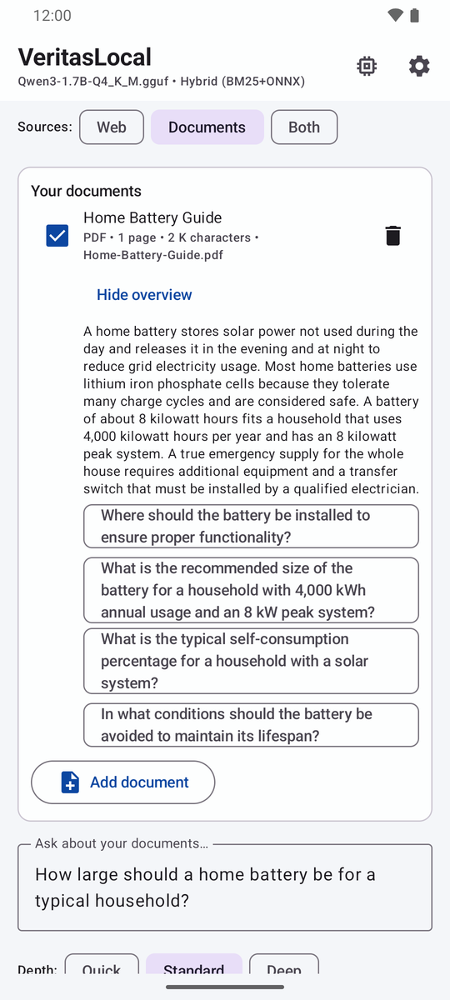
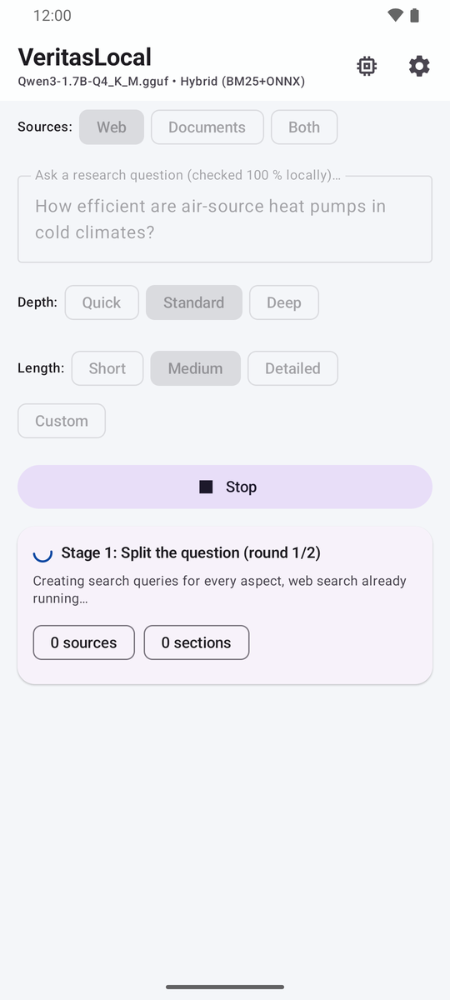
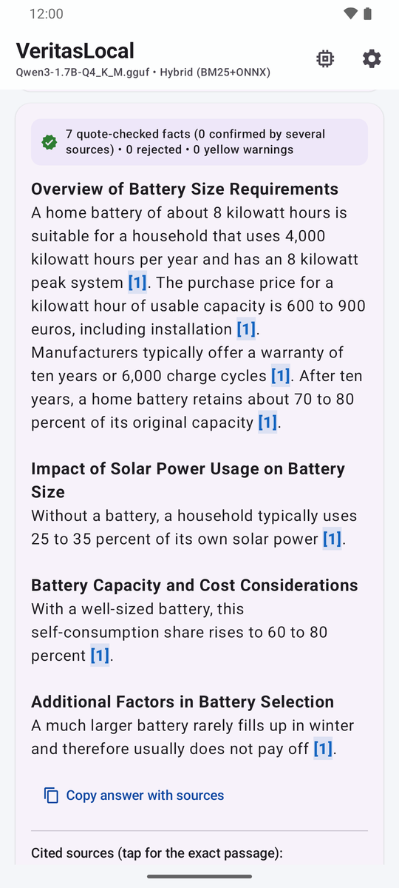
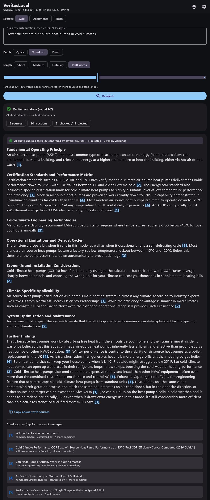
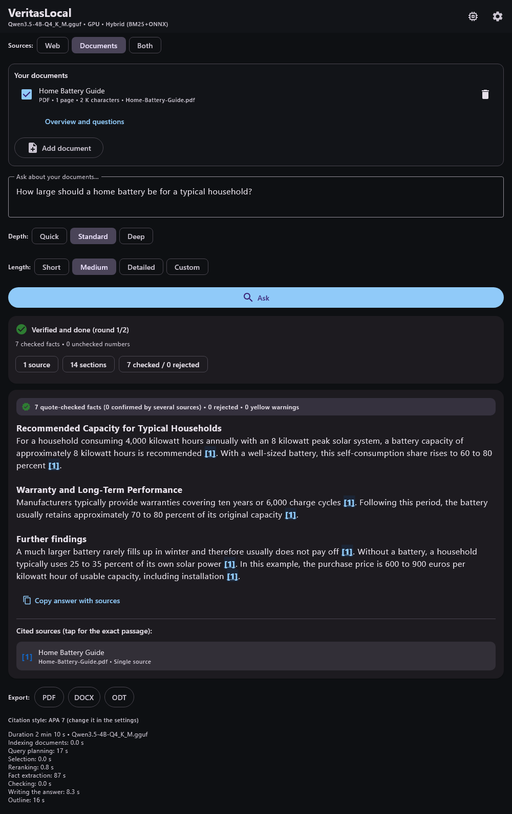

# VeritasLocal

<a href="https://buymeacoffee.com/regard2462"></a>

Deep research on your own device, for Android, Windows and Linux. A small local language model (Qwen3, Qwen3.5, Nemotron 3 Nano or LFM3, GGUF) runs through `llama.cpp`, searches the web or your own documents without a backend and answers only from sources it can quote.

<p>



</p>
<p>


</p>

## Pipeline

1. **Query plan:** the model splits the question into 2 to 3 search queries (JSON enforced by a GBNF grammar).
2. **Search and scraping:** search queries and pages are fetched in parallel over HTTP and cleaned with Jsoup. The search engines (DuckDuckGo, Bing, Startpage, Mojeek, Marginalia, your own SearXNG instance) can be switched on and off in the settings. They are asked in turn, each within its own budget per minute, and an engine that throttles or shows a captcha pauses for 15 minutes or longer. PDFs (studies, reports) are read with PdfBox (PdfBox-Android on Android), up to 40 pages. On Android a hidden WebView is used only for pages that need JavaScript; the desktop version skips such pages. `robots.txt` is respected, and blocked or rate limited pages are skipped. Wikipedia and arXiv come through their APIs at the same time. Search, sources and answer stay in the language of the question: the search engines get a region or language parameter, pages in another language are dropped, and English Wikipedia and arXiv are only used for English questions.
3. **Hybrid retrieval:** pages become chunks of about 500 characters. An in-memory BM25 keyword index (the system SQLite of many devices has no FTS5) and an ONNX embedding are merged with reciprocal rank fusion. The default embedding is the multilingual `multilingual-e5-small` with its own SentencePiece Unigram tokenizer in Kotlin (checked token by token against the Hugging Face `tokenizers` library); `all-MiniLM-L6-v2` remains as a small English-only option. Claims supported by several domains rank higher. A multilingual cross-encoder (`mmarco-mMiniLMv2-L12-H384`, ONNX int8) then scores question and chunk together and reorders the candidates of every sub-question. Depending on the depth, 8 to 21 chunks reach the model, at most 2 or 3 per domain.
4. **Quote first extraction:** the model returns claims with a verbatim quote and chunk id (GBNF JSON, temperature 0). Then it writes the answer from the checked claims only. From the standard depth on, it first builds an outline that assigns every checked claim to a section and then writes one section at a time from its claims (following the outline step of STORM).
5. **Deterministic checks in Kotlin:** every quote is matched against its chunk (or any other loaded chunk, since small models mix up chunk ids). The claim itself must use the words of its source, so translated or reinterpreted claims and terms smuggled in from the question are rejected. If the model delivers too few facts, the best matching source sentences are added verbatim, scored by the reranker. In the written answer every sentence must rest on a cited fact, otherwise it is removed; copied or invented quotes are removed too, and so are garbled paraphrases (a source word with a stray ending or a one-letter typo, two new compounds built from source words, or the same four words twice in one sentence) and copied sentence tails that start in the middle of a source sentence. A sentence that strays too far from the wording of its cited source is replaced by the source sentence itself (strict for models up to about 2B parameters, looser from 3B on), and so is a sentence that opens a section with "Sie", "Es" or "This" and has nothing to refer to. Short lines without punctuation count as headings. For German questions a fact only counts if its page names the main topic of the question, so a page that only shares a side word ("rechtliche Hürden") is dropped. Line breaks inside PDF sentences are joined (a line counts as wrapped if it nearly fills the column or ends on an article or conjunction), headings, imprint lines, literature references, service offers and lines that address the reader ("Ihr Betrieb") are no facts, a quote that spans a heading or list keeps only the line the claim rests on, a quote that opens with "Es" or "Sie" carries the sentence before it (and the claim may only name what that sentence names), a half sentence with "zwar" but no "aber" is replaced by the full source sentence, chunks are only split at sentence ends or real line ends, and sentence fragments or sentences cut off at the end of a chunk are rejected. Claims are checked for a second domain, and every number, date and amount in the answer must appear in the cited chunks. Unsupported numbers are highlighted in yellow. Tapping `[1]` opens the original passage with the quote marked. The answer can be selected and copied, or copied with its source list.
6. **Answer length:** Short, Medium or Detailed. Detailed works like the outline step of STORM: the model names subtopics of the question, the section headings of matching Wikipedia articles add more, and a second search round covers them. More pages and facts are used, and the answer is structured like a paper (concept, one section per subtopic, influencing factors and obstacles, open questions). The rules of step 5 still apply to every sentence. With **Custom** a slider sets a word target between 200 and 3,000 words. The target scales the number of search queries, pages, checked facts and sections, so a long target reads more sources and takes longer.
7. **Export:** PDF, DOCX and ODT with title page, table of contents, sections and reference list. Citation styles: APA 7, Harvard, Chicago author-date, IEEE and DIN ISO 690 (numeric). Authors, dates and site names come from the meta tags of the pages (Highwire `citation_*`, Dublin Core, Open Graph, schema.org JSON-LD, the alt text of the site logo), from the document info of PDFs and from the Wikipedia and arXiv APIs. If a page or PDF names no site, the home page of its domain is read once for the name; missing years are written as "o. J." or "n.d.". In DOCX the table of contents is a real TOC field with linked entries (Word offers to update the page numbers when the file is opened), in ODT a LibreOffice index, in the PDF it has page numbers and jump links plus bookmarks. Citations link to their reference entry, web addresses are clickable.

## Your own documents

Under "Sources" you choose Web, Documents or Both. Documents are added from the device and stay in the app folder:

- Formats: PDF, DOCX, ODT, EPUB, HTML, TXT, Markdown and images (JPG, PNG, WebP, BMP), up to 300 MB or 20 million characters each. PDFs have no page limit, so whole textbooks with 1000 pages and more fit.
- Scanned pages and images are read with Tesseract 5 (Tesseract4Android on Android, Tess4J on the desktop). Only PDF pages without a text layer go through OCR, up to 2000 pages per file. The language data for the interface language and English (`tessdata_fast`, a few MB each) is downloaded on first use. On Linux Tess4J needs the system library (package `tesseract-ocr`).
- Each document can be ticked or unticked for the next question.
- On import the text is split into paragraphs of about 900 characters and each paragraph into small search chunks of about 280 characters. Search runs on the small chunks; the model gets the whole paragraph around each hit (parent-child retrieval as in Dify). The vectors of the search chunks are stored next to the text and reused as long as the embedding model and the chunks stay the same.
- After the import a short overview is written the same way as an answer to "What is this document about?" (asked in German for German documents), so every sentence rests on a checked quote. Four suggested questions come with it; tapping one puts it into the question field. If no language model was loaded during the import, the overview can be created later.
- Every chunk knows its chapter and section. For PDFs they come from the bookmarks (table of contents), otherwise from the headings in the text. Chapter and section go into the vector, the keyword index and the line the model sees above each chunk, so a question about "Preispolitik" also finds paragraphs under that heading that never repeat the word.
- In large documents the question is first turned into search terms the way a textbook would name them (technical terms, synonyms, sub-terms) instead of web style aspects. The keyword index reduces words to a simple stem ("ökonomischen" finds "ökonomische"). For every search term the 60 best chunks go to the cross-encoder, and at the end every chosen chunk is scored once more against the original question. Chunks far behind the best one are dropped, so a stray search term cannot pull in another chapter.
- "Documents" answers only from the ticked files, with the same quote checks as for web pages. There is no limit of chunks per file.
- Questions that ask for an overview ("Worum geht es?", "Fasse zusammen", "What is this about?") take chunks spread evenly from the start to the end of every document instead of the most similar ones. If the question names a chapter ("Fasse Kapitel 3 zusammen") or a topic that is a heading, only that part of the document is used. If it names a topic of a large document that is not a heading, the normal search picks the passages.
- Importing a large book takes a while, because every chunk gets a vector once (about 6500 chunks for a textbook of 470 pages, under a minute on a desktop). The progress shows in the app and in the notification; later questions reuse the stored vectors.
- For PDFs every chunk knows its pages. The passage view shows "p. 4" or "pp. 4–5", and the reference list names the file instead of a web address.

## Background

On Android a research run, a document import (text recognition, overview) continues when the app goes to the background or is closed. A foreground service (type `dataSync`) shows the current stage with a stop button and keeps the CPU awake. When the answer is ready, a notification opens it. Android 15 limits `dataSync` services to 6 hours a day, after which the run stops.

## Languages

The interface is available in 28 languages: German, English, French, Spanish, Italian, Portuguese, Dutch, Polish, Czech, Swedish, Danish, Norwegian, Finnish, Romanian, Hungarian, Greek, Turkish, Russian, Ukrainian, Arabic, Hebrew, Hindi, Indonesian, Vietnamese, Thai, Chinese (simplified), Japanese and Korean. It follows the system language and can be switched in the settings. Arabic and Hebrew are laid out from right to left.

Questions can be asked in any of these languages. The app detects the language of a question from its script, or from common words for languages written in Latin letters, then searches with the matching region, uses the Wikipedia of that language and writes the answer in it. For Chinese, Japanese and Thai, which are written without spaces, the keyword search works on pairs of characters. How well an answer reads depends on the language skills of the chosen model. Exports use German headings and citation terms for German questions and English ones for all others.

## Build

Requires Android Studio or the Android SDK with NDK 27 or newer and CMake 3.22.1.

```bash
git clone --depth 1 https://github.com/ggml-org/llama.cpp.git app/src/main/cpp/third_party/llama.cpp
gradle assembleRelease
```

Use Gradle 8.11 or newer (the project has no wrapper files).

The release build is signed with the debug key so that it installs directly. It targets `arm64-v8a`, minSdk 28. `llama.cpp` is built with all ARM CPU variants (dotprod, fp16, i8mm, SVE, SME), and the fastest one the device supports is loaded at runtime.

### Windows and Linux

The module `desktop` shares the code of the app (search, checks, export, screens) and runs it with Compose for Desktop. Small stand-ins for the few Android classes it uses live in `desktop/src/main/kotlin`. `llama.cpp` is built separately per system and placed in `desktop/native-libs/windows-x64` or `desktop/native-libs/linux-x64` (all x86 CPU variants, the fastest is picked at runtime):

```bash
cmake -S app/src/main/cpp -B build-native -DCMAKE_BUILD_TYPE=Release -DBUILD_SHARED_LIBS=ON -DGGML_NATIVE=OFF   -DGGML_BACKEND_DL=ON -DGGML_CPU_ALL_VARIANTS=ON -DGGML_OPENMP=OFF -DLLAMA_CURL=OFF   -DLLAMA_BUILD_TESTS=OFF -DLLAMA_BUILD_EXAMPLES=OFF -DLLAMA_BUILD_SERVER=OFF -DLLAMA_BUILD_TOOLS=OFF
cmake --build build-native -j
gradle :desktop:createDistributable   # program folder, plus :desktop:packageMsi on Windows or :desktop:packageDeb on Linux
```

On Windows use MSVC with the shared runtime (the default); the runtime DLLs come with the bundled Java runtime. Data and models are stored in `%LOCALAPPDATA%\VeritasLocal` or `~/.local/share/VeritasLocal`.

On the desktop `llama.cpp` is also built with Vulkan (`-DGGML_VULKAN=ON`, needs the Vulkan SDK on Windows or `libvulkan-dev` and `glslc` on Linux). If a graphics card with a Vulkan driver is found, the model runs on it; if it does not fit into the video memory, the app falls back to the CPU. The settings show the card and can switch it off. On a desktop with an RTX 4060 Ti a document question with Qwen3 1.7B took 58 seconds instead of 97 on the CPU. Android stays on the CPU.

### Models

On first start the model manager downloads the models. All of them are Q4_K_M files from Hugging Face:

- Qwen3 0.6B, 1.7B and 4B (Apache-2.0): 1.7B for devices with less than 8 GB RAM, 4B from 8 GB. 0.6B works but writes clumsier text.
- Qwen3.5 2B and 4B (Apache-2.0): the newer generation, more fluent sentences at the same size.
- NVIDIA Nemotron 3 Nano 4B (NVIDIA Open Model License).
- Liquid LFM3 1.7B (LFM Open License, free for companies below 10 million USD revenue): the fastest of the list.

For the search, `multilingual-e5-small` is the default embedding. `multilingual-e5-base` (about 280 MB) can be chosen instead: it finds the right passage more often in large books, but indexing takes about three times as long.

The chat format comes from the template stored in the GGUF file. Models with a thinking mode get an empty thinking block, so they answer directly. A custom GGUF file can be imported as well.

## Status

Builds without errors. The full pipeline (search, PDF, reranker, extraction, verification, outline and sections, export) ran with Qwen3 0.6B and 1.7B on an x86_64 Android emulator, in the Windows version and in the Linux version (WSL). Times for a complex question at depth 2 with detailed answer, CPU only: 6 to 7 minutes on a Windows desktop with either model, about 7 minutes on Linux with 0.6B, and 9 minutes (0.6B) to 23 minutes (1.7B) on the emulator. Fact extraction takes most of the time. A run on an arm64 device is not measured yet.

The search depth sets the budget: more search queries per sub-topic, more pages, up to 21 source chunks, several extraction passes and a longer structured answer. ONNX Runtime telemetry is removed from the manifest and switched off.

## License

AGPL-3.0-or-later. `llama.cpp` (MIT) is fetched separately. Tesseract, Tesseract4Android, Tess4J and the `tessdata_fast` language data are under Apache-2.0.
